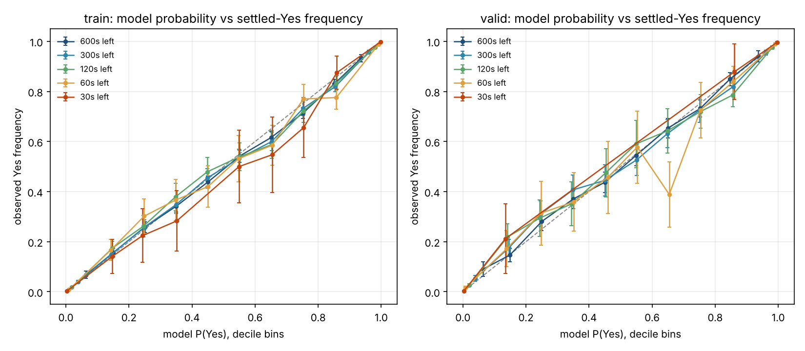
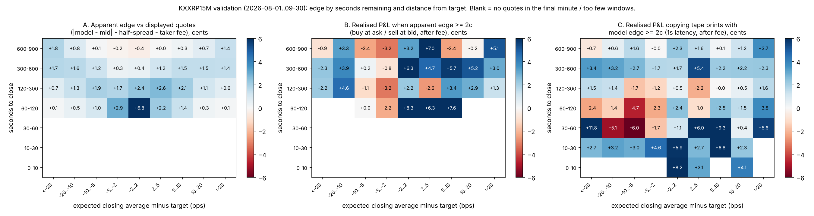

# KXXRP15M (Kalshi XRP 15-minute) — is there a tradeable edge?

Research and paper analysis only. No orders were placed, no trading account or API key was used; every request was an unauthenticated GET for public market data.
Study date: 2026-11-14. All market facts below were read live on that date; sources are numbered in [Sources](#sources).

## Verdict

**No edge.** None of the three strategies fixed in advance passed the pass gate on validation, so under the pre-registered rules the answer is "no edge". One lead found afterwards is unresolved and needs order-book data this study could not collect.

- **Pre-registered tests (August–September, 1 s latency, fills limited to prints that actually traded).** Best result: taker with the BTC/Binance lead-lag term, +0.87c per contract after fees, 95% interval [-0.39, +2.09]. It misses the +1.0c bar, the interval includes zero, drawdown was $1,675 against a $1,000 limit, and one day supplied 22% of the profit. The plain taker made +0.55c; the maker lost 1.70c.
- **Who earns the money today.** Across 275M contracts in August–September, takers lost 1.5c per contract after fees (0.84c of it fees) and makers earned 0.7c with no fee.
- **The fair-value model works but is not better than the market.** It is well calibrated out of sample (it says 75%, the window settles Yes 75% of the time). Against Kalshi's mid it was slightly less accurate in June–July and slightly more accurate in August–September.
- **Signals.** BTC and Binance lead the index by about one second; that is real and worth a small fraction of a cent. Previous-window momentum, hour of day, day of week and volatility regime add nothing out of sample. Order-book imbalance could not be tested.
- **The open lead (not evidence of an edge).** Taking the displayed quote at minute boundaries when the model sees at least 3c of edge returned +2.7c [+1.2, +4.3] per contract in August–September but -0.5c [-2.8, +1.8] in June–July. It was found after the planned tests were used up, the two periods disagree, and it assumes the displayed quote had size, which cannot be checked without historical books.
- **What is missing.** Kalshi has no historical order books. The 1-second recorder is written and ran for 61 minutes; the required 14 days need an always-on host. Until then fills cannot be modelled and the holdout (2026-10-01 onward) stays locked.

## 1. Contract summary (verified live)

| Item | What the rules say | Source |
|---|---|---|
| Question | "XRP price up in next 15 mins?" One binary market per 15-minute window, 96 per day | [S2] |
| Settlement index | CF Benchmarks XRPUSD_RTI (Real Time Index), published once per second | [S1] [S2] |
| Closing value | Simple average of the 60 RTI prints in the last minute before the close, **rounded to 4 decimals** | [S2] [S3] |
| Target price | The same 60-second average taken in the minute before the window **opens** (shown as "Target Price"; it is `floor_strike` in the API and is TBD until the open) | [S2] |
| Payout | Yes pays $1 if closing value is **at least** the target (`strike_type = greater_or_equal`): a tie pays Yes | [S2] [S3] |
| Missing data | "If no data is available or incomplete on the Expiration Date at the Expiration Time, then affected strikes resolve to No" | [S3] |
| Price ticks | `tapered_deci_cent`: $0.001 steps below $0.10 and above $0.90, $0.01 steps in between | [S2] |
| Trading hours | 24 hours, 7 days, except a weekly maintenance pause **Thursday 3:00–5:00 AM ET** (orders cannot be placed or amended; cancels allowed) | [S4] [S5] [S6] |
| Settlement timing | `settlement_timer_seconds = 1`; settlement was recorded about 4.6 s after the close in the three settled markets inspected | [S2] |
| Position accountability | $25,000 per strike, per member | [S3] |

**What the data adds to the rule text** (checked on 21,766 settled windows, 2026-02-11 → 2026-09-30, against Kalshi's own per-second index series [S7]):

- The closing value equals the series value stamped one second *before* the close, i.e. the mean of the prints stamped T−60 … T−1, rounded to 4 dp, in **99.92%** of windows. The few misses are exact half-way cases (5th decimal exactly 5), which round either way.
- The target equals the same quantity one second before the open in **99.91%** of windows — each window's target is the previous window's closing value.
- `result == (closing value >= target)` in **99.98%** of windows.
- Rounding to 4 decimals makes exact ties common: **1.71%** of windows closed exactly on the target, and every one resolved Yes. With XRP near $1, one rounding step is about 1 basis point.
- 65 archived markets have no `floor_strike` in the API; for those the target was rebuilt from the index.

## 2. Fees

`GET /series/KXXRP15M` returns `fee_type: "quadratic"`, `fee_multiplier: 1` [S1]. `GET /series/fee_changes` returns no past or scheduled changes for the series [S8]. Per the fee schedule ("last updated and effective July 7, 2026") [S9] and the API's definition of the fee types [S10]:

- **Taker:** `fee = round_up(0.07 × contracts × P × (1 − P))`, P in dollars.
- **Maker:** resting orders are charged only for series with a maker multiplier. The default maker multiplier is 0 and KXXRP15M is not on the non-standard list, and its fee type is `quadratic`, not `quadratic_with_maker_fees`. **Maker fee = 0.**
- **Rounding:** the fee is rounded up so that the order's total balance change lands on a whole cent for accounts that are not direct exchange members (on $0.0001 for direct members); the round-up is shared across all fills of one order [S11]. Small orders therefore pay proportionally more.
- No settlement fee [S9].

| Price | Taker fee per contract (formula) | 1-contract order | 10-contract order, per contract | 100-contract order, per contract | Taker fee as % of stake | Maker fee |
|---|---|---|---|---|---|---|
| 10c | 0.63c | 1c | 0.7c | 0.63c | 6.3% | 0c |
| 30c | 1.47c | 2c | 1.5c | 1.47c | 4.9% | 0c |
| 50c | 1.75c | 2c | 1.8c | 1.75c | 3.5% | 0c |
| 70c | 1.47c | 2c | 1.5c | 1.47c | 2.1% | 0c |
| 90c | 0.63c | 1c | 0.7c | 0.63c | 0.7% | 0c |

Each window opens near 50c, where the taker fee peaks at 1.75c per contract (2c on a single contract). A taker who buys at 50c and is right 50% of the time loses the fee plus half the spread on every trade.

## 3. Data inventory

| Dataset | Source | Coverage | Resolution | Size |
|---|---|---|---|---|
| Settled windows and outcomes | `/historical/markets` + `/markets` [S12] | 2026-02-11 (series start) → 2026-11-14 | one row per window | 26,134 markets listed; 16,060 train, 5,789 validation, 4,285 holdout (locked) |
| XRP index (trailing-60 s mean of XRPUSD_RTI) | `/live_data/events/{event}` [S7] | 2026-02-11 → 2026-09-30 | 1 second | 19,629,616 seconds |
| Raw 1-second RTI | recovered from the series above (section 4) | same | 1 second | 97.1% of the span |
| Kalshi trade tape | `/historical/trades` + `/markets/trades` [S12] | 2026-06-01 → 2026-09-30 (122 days) | every trade, with taker side | 18,123,308 trades, 381M contracts |
| Kalshi 1-minute bid/ask | market candlesticks [S13] | 2026-06-01 → 2026-09-30 | 1 minute | 6,180 windows (sample) |
| Binance XRPUSDT and BTCUSDT spot | data.binance.vision 1s klines [S14] | 2026-02-10 → 2026-09-30 | 1 second | 233 days each, none missing |
| Binance XRPUSDT and BTCUSDT perpetual | data.binance.vision aggTrades, built into 1 s bars [S14] | same | 1 second | 233 days each, none missing |
| Live order book (recorder) | `/markets/{ticker}/orderbook` [S15] | 61 minutes on 2026-11-14 | 1 second | 3,495 snapshots — far short of the 14 days required |

**How far back the API goes.** The series' first window closed 2026-02-11 05:15 UTC. Kalshi serves the per-second index for any 15-minute event for the hour before it matures, so the index is available for the whole life of the series. Markets, trades and candlesticks older than the archive cutoffs (2026-09-15 on the study date) come from the `/historical/*` endpoints [S16]. **Historical order books are not available from any endpoint**; only the current book can be read.

**Gaps, outages and the weekly pause**

- *Weekly pause.* 31 Thursdays have no listed windows around the maintenance pause. Through June 18, 12 windows were skipped each Thursday (listing stopped about an hour before the pause began); from June 25, 9 windows; from August 27 exactly the 8 windows closing 3:15–5:00 AM ET. The first window after the pause closes 5:15 AM ET.
- *Unscheduled listing gap.* No windows between 2026-05-10 04:00 and 2026-05-10 13:45 UTC (38 windows missing).
- *Unscheduled listing gap.* No windows between 2026-05-15 04:00 and 2026-05-15 14:00 UTC (39 windows missing).
- *Index short gaps.* 959 gaps of at most 103 s (median 5 s, 10,661 s in total). All fall on weekdays and 93% start between 20:00 and 02:00 UTC. For up to a minute after each gap Kalshi's series is not a clean 60-print average, so those seconds are treated as missing too (9,870 s).
- *Index outage.* 2026-04-24 17:25:53 → 2026-04-24 17:47:56 UTC (1,324 s).
- *Index around the pause.* The index was requested only for hours that have a listed window, so it has matching 2–3 hour holes on Thursdays and on the two unscheduled gaps; these are "not requested", not confirmed outages.
- *Effect on the sample.* A window is used only if the raw index is complete from 60 s before the open to the close: 15,745 of 16,059 train windows (98.0%) and 5,768 of 5,786 validation windows (99.7%).
- *Binance.* No missing daily files. Longest run of seconds without a trade: XRP spot 54 s, XRP perp 22 s, BTC spot 13 s, BTC perp 15 s. XRP spot has no trade in 48% of seconds, so the perpetual (16%) is the better 1-second reference.
- *Order-book recorder.* `recorder/record_book.py` snapshots the full book every second. It ran for 61 minutes in this session (95% of seconds captured, median request latency 126 ms) as a functional test. This research container is temporary, so the 14-day run has **not** happened; fills against displayed size could not be modelled from books.

**Split (fixed in `PREREG.md` before any outcome was analysed).** Train 2026-02-11 → 07-31, validation 2026-08-01 → 09-30, holdout 2026-10-01 onward. The holdout was never loaded: no index, trades or quotes were downloaded for it and the loader drops its rows. Trades and quotes were pulled for June–September only, so anything that needs market prices uses June–July as train and August–September as validation.

## 4. Fair-value model

**Recovering the raw index.** Kalshi publishes the trailing 60-second mean A(t), not the 1-second print R(t). Because A is a mean of 60 prints on a $0.00001 grid, `60·A(t)` is an integer number of ticks and `R(t) − R(t−60) = 60·(A(t) − A(t−1))` exactly. Within each gap-free stretch this fixes R up to a pattern that repeats every 60 s, which is chosen to make R smoothest. Checks: 1-second changes of the recovered R have a correlation of about 0.7 with Binance spot changes in the same second, and their autocorrelation at a 60-second lag is below 0.02, so no visible artefact remains. Residual error is a few ticks (about 0.2 bps).

**State variables** at second *t* of a window that settles on the prints stamped T−60 … T−1:

- **Distance from target, in index terms.** `μ(t)` = the expected closing average. With more than 60 s left, `μ(t) = R(t)`, the latest raw print — *not* the displayed trailing average, which lags the raw print by about 30 s. Inside the final minute, `μ(t) = (sum of closing-minute prints already seen + number still to come × R(t)) / 60`. Distance is `ln(μ(t) / K*)` with `K* = target − 0.00005`, the lowest closing average that still rounds up to the target.
- **Seconds remaining** `τ`, to the final print.
- **Short-horizon realised volatility** `σ²(t)`: a forecast of per-second variance over the next 15 minutes from realised variance of 30-second index returns over the trailing 5 min, 15 min, 1 h, 6 h and 24 h plus hour-of-day effects (log-linear regression fitted on train).

**Baseline probability, with the averaging modelled directly.** For a random walk the variance of the closing 60-second average, seen from *t*, is `σ² × g(τ)` where

- `g(τ) = τ − 39.5` for τ ≥ 60 (averaging removes about 40 s worth of variance), and
- `g(τ) = τ(τ+1)(2τ+1) / 21600` for τ < 60 — only the prints still to come matter, each weighted by how many closing-minute seconds it affects. At τ = 30 this is 2.6 s worth of variance instead of 30.

`z = ln(μ/K*) / sqrt(σ² g(τ))` and `P(Yes) = T_ν(s_b · z)`: a Student-t distribution (fat tails) with ν = 2.66 and one scale per time bucket, all fitted by maximum likelihood on train only.

| Fitted on train | 0-10 | 10-30 | 30-60 | 60-120 | 120-300 | 300-600 | 600-900 |
|---|---|---|---|---|---|---|---|
| scale s_b | 1.49 | 2.06 | 1.99 | 1.82 | 1.62 | 1.41 | 1.26 |

Volatility forecast: R² = 0.66 on train, 0.79 on validation (log variance of the next 15 minutes). Weights on trailing log variance: 5 min 0.13, 15 min 0.15, 60 min 0.38, 360 min 0.16, 1440 min 0.15.

**Does modelling the averaging matter?** Log-loss (lower is better; 0.693 = coin flip) against settled outcomes, sampled every 5 s in every window. "Chart model" uses what the Kalshi chart shows (the trailing average as the current price, variance proportional to time left).

| Model | Split | Log-loss | Brier | τ 0-10 | τ 10-30 | τ 30-60 | τ 60-120 | τ 120-300 | τ 300-600 | τ 600-900 |
|---|---|---|---|---|---|---|---|---|---|---|
| Chart model | train | 0.4358 | 0.1451 | 0.019 | 0.054 | 0.107 | 0.175 | 0.294 | 0.461 | 0.620 |
| Chart model | valid | 0.4369 | 0.1456 | 0.016 | 0.056 | 0.120 | 0.195 | 0.312 | 0.454 | 0.614 |
| This model | train | 0.4212 | 0.1398 | 0.007 | 0.020 | 0.063 | 0.147 | 0.277 | 0.449 | 0.612 |
| This model | valid | 0.4226 | 0.1403 | 0.003 | 0.019 | 0.070 | 0.166 | 0.295 | 0.445 | 0.605 |

The model does not degrade out of sample (validation log-loss 0.4226 vs train 0.4212). Nearly all the gain over the chart model is in the last two minutes.

## 5. Calibration



*Model probability vs how often the window settled Yes, one observation per window at each time-to-close, decile bins, 95% binomial intervals. Left: train. Right: validation.*

Validation, all sampled seconds pooled:

| Model says | Settled Yes | Rows |
|---|---|---|
| 3.1% | 3.6% | 177,528 |
| 14.9% | 15.5% | 74,232 |
| 25.1% | 26.5% | 70,051 |
| 35.1% | 36.1% | 79,273 |
| 45.2% | 45.1% | 95,550 |
| 54.8% | 55.0% | 101,250 |
| 64.9% | 65.8% | 82,995 |
| 75.0% | 74.8% | 77,313 |
| 85.1% | 84.6% | 82,073 |
| 96.9% | 97.2% | 190,991 |

When the model says 70–80% the window settles Yes about 75% of the time; the largest gap in any decile is about 1.5 percentage points. The model is well calibrated out of sample.

## 6. Signals tested one at a time

Each signal was added alone to the baseline; its coefficient was fitted on train. ΔLL is the change in log-loss (negative = better). *t* is computed across days. The pre-registered rule keeps a signal only if it improves train **and** has the same sign on validation; the last column applies that rule mechanically, and the notes below say which effects are large enough to matter.

| Signal | Coefficient | ΔLL train ×10⁴ (t) | ΔLL validation ×10⁴ (t) | Same sign on validation |
|---|---|---|---|---|
| Binance XRP perp minus index, last 10 s | +0.074 | -0.20 (-3.1) | -0.10 (-1.0) | yes |
| Binance XRP spot minus index, last 10 s | +0.075 | -0.20 (-3.7) | -0.24 (-1.6) | yes |
| BTC perp return, last 1 s | +0.234 | -0.37 (-3.7) | -0.38 (-4.1) | yes |
| BTC spot return, last 1 s | +0.192 | -0.24 (-3.3) | -0.28 (-3.8) | yes |
| XRP perp gap + BTC perp return together | +0.075, +0.221 | -0.57 (-4.8) | -0.45 (-2.9) | yes |
| Previous window's return (momentum/reversal) | -0.055 | -8.14 (-3.1) | -0.71 (-0.0) | yes |
| Previous window's return, first 5 minutes only | -0.061 | -13.73 (-3.3) | +1.19 (+0.3) | no |
| Previous window's outcome (up/down) | -0.034 | -2.75 (-1.9) | -1.14 (-0.5) | yes |
| Volatility regime (terciles) — width | 3 params | -0.03 (+0.1) | -0.20 (-0.8) | yes |
| Volatility regime (terciles) — up/down bias | 3 params | -2.40 (-1.7) | +3.79 (+1.7) | no |
| Hour of day — up/down bias | 24 params | -6.43 (-2.9) | +12.18 (+3.1) | no |
| Hour of day — width | 24 params | -3.18 (-2.1) | +4.80 (+2.4) | no |
| Day of week — up/down bias | 7 params | -5.95 (-2.8) | +0.74 (+0.2) | no |
| Day of week — width | 7 params | -1.72 (-2.0) | +1.42 (+1.0) | no |
| Kalshi taker-flow imbalance, last 60 s (Jun–Sep only) | -0.004 | -0.01 (+0.1) | +0.01 (+0.4) | no |
| Order-book imbalance | – | not testable | not testable | needs recorder data |

**BTC and Binance lead-lag in detail.** Regression of the index's *next* h-second return on the reference's *last* L-second move (for XRP references: Binance move minus the index's own move over the same L seconds). Train period; validation in brackets.

| Reference | Lookback L | R², next 1 s | R², next 10 s | R², next 60 s |
|---|---|---|---|---|
| Binance XRP perp | 1 s | 6.50% [8.74%] | 1.01% [0.39%] | 0.17% [0.03%] |
| Binance XRP perp | 10 s | 4.71% [5.00%] | 1.11% [0.41%] | 0.23% [0.34%] |
| Binance XRP perp | 60 s | 3.21% [2.87%] | 0.99% [0.56%] | 0.23% [0.37%] |
| Binance XRP spot | 1 s | 4.95% [7.88%] | 0.71% [1.39%] | 0.12% [0.29%] |
| Binance XRP spot | 10 s | 2.99% [5.81%] | 0.67% [0.80%] | 0.14% [0.15%] |
| Binance XRP spot | 60 s | 2.10% [3.86%] | 0.60% [1.31%] | 0.13% [0.40%] |
| Binance BTC perp | 1 s | 4.92% [4.24%] | 1.03% [0.82%] | 0.22% [0.16%] |
| Binance BTC perp | 10 s | 0.70% [0.45%] | 0.47% [0.16%] | 0.16% [0.21%] |
| Binance BTC perp | 60 s | 0.08% [0.13%] | 0.17% [0.25%] | 0.10% [0.07%] |
| Binance BTC spot | 1 s | 4.04% [3.56%] | 0.87% [0.73%] | 0.19% [0.12%] |
| Binance BTC spot | 10 s | 0.50% [0.32%] | 0.39% [0.12%] | 0.15% [0.18%] |
| Binance BTC spot | 60 s | 0.05% [0.11%] | 0.14% [0.22%] | 0.09% [0.05%] |

- The lead is real but short. Binance's XRP perpetual explains 6.5% of the index's next 1-second move and BTC's last second explains 4.9%; by 60 s ahead both are near 0.2%. The index simply updates about a second after Binance.
- In probability terms the lead-lag signals improve log-loss by 0.2–0.6 ×10⁻⁴: statistically detectable, same sign on validation, and worth a small fraction of a cent per contract. They help only where one second matters, in the last two minutes.
- Previous-window reversal looks strong on train (t = −3.1) and all but disappears on validation (one-eleventh the size, t = 0.0). Hour of day and day of week fit train and make validation worse (hour of day significantly so). None is usable.
- Volatility regime adds nothing measurable beyond the volatility forecast already in the model. Kalshi taker-flow imbalance has no predictive value. Order-book imbalance cannot be tested without recorded books.

## 7. Edge test against the market

Sample: 5,739 train windows (June–July) and 5,768 validation windows (August–September); 18,060,509 trades inside those windows. A typical validation window has 2,311 trades and 43,523 contracts (June–July: 586 and 15,763).

### 7.1 Who makes money now

Every trade on the tape has a taker (pays the fee) and a maker (rests, pays nothing). Settling each trade at the window's outcome, per contract:

| Period | Takers, after fee | Fee paid | Takers, before fee | Makers | t across days (takers) |
|---|---|---|---|---|---|
| train (Jun–Jul) | -1.71c | 0.88c | -0.83c | +0.83c | -16 |
| validation (Aug–Sep) | -1.49c | 0.84c | -0.65c | +0.65c | -26 |

Validation, by seconds to close:

| Sec to close | Contracts | Takers after fee | Fee | Makers |
|---|---|---|---|---|
| 600-900 | 56.9M | -2.73c | 1.47c | +1.26c |
| 300-600 | 65.6M | -1.78c | 1.09c | +0.69c |
| 120-300 | 65.0M | -1.27c | 0.74c | +0.53c |
| 60-120 | 36.5M | -0.86c | 0.48c | +0.38c |
| 30-60 | 29.6M | -0.46c | 0.26c | +0.20c |
| 10-30 | 15.1M | -0.64c | 0.17c | +0.47c |
| 0-10 | 6.6M | -0.25c | 0.09c | +0.16c |

Takers as a group lose about 1.5c per contract, a little more than half of it fees, and the loss is consistent from day to day. It is largest early in the window, where prices sit near 50c and the fee is highest. Makers as a group earn about 0.7c per contract with no fee. That is the only reliably positive number in this study, and it belongs to whoever already holds queue priority.

**Is the market price itself calibrated?** Contract-weighted, at trade prices, validation:

| Price bin | Mean price | Settled Yes | Contracts |
|---|---|---|---|
| 0.00-0.02 | 0.5c | 0.7% | 37.4M |
| 0.02-0.05 | 3.3c | 3.0% | 11.4M |
| 0.05-0.10 | 7.2c | 6.8% | 12.5M |
| 0.10-0.20 | 14.5c | 13.6% | 17.2M |
| 0.20-0.30 | 24.5c | 24.1% | 17.7M |
| 0.30-0.40 | 34.6c | 35.0% | 19.0M |
| 0.40-0.50 | 44.6c | 44.7% | 20.7M |
| 0.50-0.60 | 54.4c | 55.2% | 21.2M |
| 0.60-0.70 | 64.9c | 66.7% | 21.4M |
| 0.70-0.80 | 75.0c | 76.8% | 16.1M |
| 0.80-0.90 | 84.9c | 85.4% | 19.7M |
| 0.90-0.95 | 92.8c | 93.4% | 13.0M |
| 0.95-0.98 | 96.7c | 97.5% | 11.6M |
| 0.98-1.00 | 99.4c | 99.7% | 36.5M |

Prices are close to calibrated. In validation, 60–80c prices settled Yes about 2 points more often than priced and 10–20c prices about 1 point less often; in train every bin settled Yes more often than priced. The pattern is not stable across the two periods and is smaller than the taker fee in the middle of the range.

### 7.2 Model against the displayed quote

1-minute bid/ask closes for 3,084 train and 3,096 validation windows (sample), minutes 1–14 of each window. Median spread 2c in June–July, 1c in August–September (mean 1.25c). The model is evaluated one second *before* the quote (the pre-registered 1 s latency).

|  | Train | Validation |
|---|---|---|
| Log-loss, Kalshi mid | 0.4427 | 0.4374 |
| Log-loss, model (1 s stale) | 0.4440 | 0.4363 |
| Log-loss, blend fitted on train | 0.4419 | 0.4356 |
| Mean absolute gap, model vs mid | 2.55c | 2.66c |
| Mean cost to cross (half spread + fee) | 2.20c | 1.68c |
| Share of quote-minutes with apparent edge > 0 | 52% | 62% |

The 1 s-stale model is slightly less accurate than the Kalshi mid in June–July and slightly more accurate in August–September. A blend fitted on train (weights 0.74 mid, 0.30 model on the log-odds) beats both in both periods, so the model carries some information the mid does not, but the mid carries more. The model disagrees with the mid by about 2.6c on average, which is about the cost of crossing; most disagreements are too small to trade.

### 7.3 Edge grid

Edge = model probability minus market price, after the taker fee and half the spread (i.e. buying at the ask or selling at the bid, whichever is better). Rows: seconds to close. Columns: expected closing average minus target, in basis points. Validation period. Quotes exist only at minute boundaries, so the last minute is covered by the trade-tape grid (table C).



**A. Apparent edge against displayed quotes, cents per contract** (mean over quote-minutes of the better side; positive = model sees value after costs)

| sec to close \ distance (bps) | <-20 | -20..-10 | -10..-5 | -5..-2 | -2..2 | 2..5 | 5..10 | 10..20 | >20 |
|---|---|---|---|---|---|---|---|---|---|
| 600-900 | +1.8 | +0.8 | +0.1 | -0.2 | -0.4 | +0.0 | +0.3 | +0.7 | +1.4 |
| 300-600 | +1.7 | +1.6 | +1.2 | +0.3 | +0.4 | +1.2 | +1.5 | +1.5 | +1.4 |
| 120-300 | +0.7 | +1.3 | +1.9 | +1.8 | +2.4 | +2.6 | +2.1 | +1.1 | +0.6 |
| 60-120 | +0.1 | +0.5 | +1.0 | +2.9 | +6.8 | +2.2 | +1.4 | +0.3 | +0.1 |

**B. Realised P&L, cents per contract, when the apparent edge was at least 2c** (settled at the outcome, after fee; cells with fewer than 30 windows blank)

| sec to close \ distance (bps) | <-20 | -20..-10 | -10..-5 | -5..-2 | -2..2 | 2..5 | 5..10 | 10..20 | >20 |
|---|---|---|---|---|---|---|---|---|---|
| 600-900 | -0.9 | +3.2 | -2.4 | -3.2 | +3.2 | +7.0 | -2.4 | -0.2 | +5.1 |
| 300-600 | +2.3 | +3.9 | +0.2 | -0.8 | +6.3 | +4.7 | +5.7 | +5.2 | +3.0 |
| 120-300 | +2.2 | +4.6 | -1.1 | -3.2 | +2.2 | -2.6 | +3.4 | +2.9 | +1.3 |
| 60-120 | – | – | +0.1 | -2.2 | +8.3 | +6.3 | +7.6 | – | – |

**C. Realised P&L, cents per contract, from copying actual tape prints where the 1 s-stale model edge was at least 2c** (all seconds, including the final minute)

| sec to close \ distance (bps) | <-20 | -20..-10 | -10..-5 | -5..-2 | -2..2 | 2..5 | 5..10 | 10..20 | >20 |
|---|---|---|---|---|---|---|---|---|---|
| 600-900 | -0.7 | +0.6 | +1.6 | -0.0 | +2.3 | +1.6 | +0.1 | +1.2 | +3.7 |
| 300-600 | +3.4 | +3.2 | +2.7 | +1.7 | +1.6 | +5.4 | +2.2 | +2.2 | +2.3 |
| 120-300 | +1.5 | +1.4 | -1.7 | -1.2 | +0.5 | -2.2 | -0.0 | +0.5 | +1.6 |
| 60-120 | -2.4 | -1.4 | -4.7 | -2.3 | +2.4 | -1.0 | +2.5 | +1.5 | +3.8 |
| 30-60 | +11.8 | -5.1 | -6.0 | -1.7 | +1.1 | +6.0 | +9.3 | +0.4 | +5.6 |
| 10-30 | +2.7 | +3.2 | +3.0 | +4.6 | +5.9 | +2.7 | +6.8 | +2.3 | – |
| 0-10 | – | – | – | – | +8.2 | +3.1 | – | +4.1 | – |

**D. Average model edge at every executable print, cents per contract** (model minus the price a taker actually paid, after fee)

| sec to close \ distance (bps) | <-20 | -20..-10 | -10..-5 | -5..-2 | -2..2 | 2..5 | 5..10 | 10..20 | >20 |
|---|---|---|---|---|---|---|---|---|---|
| 600-900 | -3.4 | -3.4 | -3.3 | -3.4 | -3.6 | -3.5 | -3.3 | -3.2 | -2.9 |
| 300-600 | -1.9 | -2.6 | -3.0 | -3.3 | -3.4 | -3.1 | -2.8 | -2.5 | -1.6 |
| 120-300 | -0.8 | -1.5 | -2.3 | -3.4 | -3.8 | -3.1 | -2.2 | -1.5 | -0.7 |
| 60-120 | -0.3 | -0.9 | -2.0 | -3.2 | -4.9 | -2.9 | -1.7 | -0.9 | -0.3 |
| 30-60 | -0.2 | -0.3 | -0.7 | -1.8 | -4.1 | -1.6 | -0.6 | -0.4 | -0.1 |
| 10-30 | -0.3 | -0.2 | -0.4 | -0.7 | -2.5 | -0.3 | -0.6 | -0.2 | -0.2 |
| 0-10 | -0.3 | -0.1 | -0.2 | -0.3 | -1.0 | -0.6 | -0.1 | -0.1 | -0.2 |

**B (train). The same as B for June–July**, for comparison

| sec to close \ distance (bps) | <-20 | -20..-10 | -10..-5 | -5..-2 | -2..2 | 2..5 | 5..10 | 10..20 | >20 |
|---|---|---|---|---|---|---|---|---|---|
| 600-900 | -1.2 | -2.3 | -2.0 | +2.6 | -1.2 | +1.4 | +1.1 | +1.6 | +0.6 |
| 300-600 | +1.5 | -0.6 | -1.3 | -0.5 | -6.7 | -1.2 | -2.2 | -2.2 | -2.4 |
| 120-300 | – | -1.7 | -1.3 | +2.0 | -1.1 | +3.3 | +2.1 | -1.3 | – |
| 60-120 | – | – | – | +6.2 | +7.9 | +4.2 | – | – | – |

Reading the grids: at a typical print the model says the taker is overpaying by 0.1–5c in every cell (D), consistent with takers' realised losses. The apparent edge against quotes (A) is largest near the target with 1–5 minutes left, where a small index move changes the probability most. Realised results in August–September (B, C) are positive in most cells with 5–10 minutes left and mixed elsewhere; in June–July (B train) they are mixed everywhere. Each cell rests on a few hundred windows at most, and individual cells are not significant.

### 7.4 Pre-registered strategies and the pass gate

Three configurations, thresholds chosen on train only, each evaluated once on validation. Execution: 1 s decision latency; a taker order fills only against a print that actually occurred on the same side at that price, up to the printed size; a maker order fills only when a later print trades strictly through it; at most 100 contracts per window; fees rounded up per order; no trading in the last 10 s.

| Config | θ (from train) | Windows / days | Net per contract [95% CI] | Max drawdown | Best day's share of profit | Sample / expectancy / drawdown / concentration | Gate |
|---|---|---|---|---|---|---|---|
| T1 taker: copy prints where model edge ≥ θ | 8c | 4,758 / 61 | +0.55c [-0.71, +1.76] | $1,994 | 36% | pass / **fail** / **fail** / **fail** | **FAIL** |
| T2 taker: same, model + BTC/Binance lead-lag | 8c | 4,738 / 61 | +0.87c [-0.39, +2.09] | $1,675 | 22% | pass / **fail** / **fail** / **fail** | **FAIL** |
| M1 maker: quote model ± θ, refresh every 10 s | 5c | 5,728 / 61 | -1.70c [-2.82, -0.57] | $10,625 | – | pass / **fail** / **fail** / **fail** | **FAIL** |

Gate (from `PREREG.md`): ≥ 500 traded windows on ≥ 40 days; ≥ +1.0c per contract after fees with the day-block bootstrap 95% lower bound above zero; max drawdown ≤ $1,000 at 100 contracts per window; no day above 20% of total profit.

Train scan that selected θ (net cents per contract, [95% CI]):

| Config | θ = 1c | θ = 2c | θ = 3c | θ = 5c | θ = 8c |
|---|---|---|---|---|---|
| T1 | -0.61 [-1.6, +0.4] | -0.67 [-1.8, +0.4] | -0.53 [-1.6, +0.5] | -0.34 [-1.6, +0.9] | +0.65 [-0.7, +2.1] |
| T2 | -0.75 [-1.7, +0.3] | -0.56 [-1.7, +0.6] | -0.45 [-1.5, +0.6] | -0.19 [-1.4, +1.0] | +1.01 [-0.4, +2.4] |
| M1 | -1.77 [-2.8, -0.7] | -1.13 [-2.1, -0.1] | -0.50 [-1.5, +0.5] | -0.14 [-1.3, +1.0] | – |

**All three fail.** The two taker configs are positive on validation but small: both point estimates are below the +1.0c bar, both intervals include zero, both exceed the drawdown limit, and both draw more than 20% of profit from one day. On train, thresholds of 1–5c lose money (-0.61c to -0.34c per contract); only 8c is positive, which is why 8c was selected, and its train interval also includes zero. The maker config loses at every threshold: under the trade-through rule it is filled only when the price moves through its quote, which is when the quote was wrong. That rule is deliberately harsh; real makers also get filled at their price and, as a group, earn 0.7c per contract (7.1). Whether a newcomer can get those fills is a queue-position question that needs order-book data.

### 7.5 Post-hoc check: taking displayed quotes (not gate-eligible)

After the three pre-registered tests were spent, the quote data suggested a different execution rule: at each minute boundary, take 10 contracts at the displayed quote when the model's edge after fee is at least θ (cap 100 per window). This was looked at on validation without being pre-registered, it assumes the displayed quote had at least 10 contracts (unverified — there are no historical books), and it is reported for transparency only.

| θ | Train: net per contract [95% CI] | Validation: net per contract [95% CI] | Validation: best day's share |
|---|---|---|---|
| 2c | -0.45c [-2.3, +1.4], 2,424 windows | +2.30c [+1.0, +3.5], 2,616 windows | 9% |
| 3c | -0.49c [-2.8, +1.8], 1,884 windows | +2.74c [+1.2, +4.3], 2,128 windows | 9% |
| 5c | +1.08c [-2.7, +4.7], 1,026 windows | +4.17c [+2.1, +6.2], 1,281 windows | 10% |
| 8c | +1.63c [-4.5, +7.1], 384 windows | +5.72c [+2.4, +9.1], 532 windows | 13% |

In August–September every threshold clears the gate's numeric bars; in June–July none is distinguishable from zero. Reasons not to treat this as an edge:

1. **Post-hoc.** The rule was chosen after seeing validation data. It has not been tested on untouched data.
2. **The two periods disagree.** The model was less accurate than the Kalshi mid in June–July (log-loss 0.4440 vs 0.4427) and more accurate in August–September (0.4363 vs 0.4374). Volume more than quadrupled between June and September, so the later period may reflect a changing market, or chance.
3. **Displayed size is unknown.** In the 61-minute live book sample the best quote held fewer than 10 contracts 11% of the time on each side, and filling 10 contracts cost about 0.1c more than the best quote on average (0.2c for 100). That average is small, but the stale quotes the model likes may be exactly the thin ones.
4. **It disagrees with the tape-based tests.** The same model made only +0.6c to +0.9c per contract in the same months when restricted to prices at which someone actually traded.

The rule is now frozen as configuration Q1 in `PREREG.md` (θ = 3c, 10 contracts per minute boundary, displayed size required) for a single test on the holdout once 14 days of recorded books exist.

## 8. Risk rules (proposal only — nothing here is switched on)

These would apply to a paper-trading phase and, only if the gate is ever passed on the holdout, to a first live phase.

| Rule | Proposed value | Why |
|---|---|---|
| Max stake per window | 100 contracts, one direction per window | The gate was defined at 100 contracts; median displayed size in the live sample was 250 contracts at the best bid and 250 at the best ask |
| Max daily loss | $300; stop for the rest of the UTC day | About five full-size losing windows at mid-range prices |
| Max consecutive losing windows | 6, then stand down for 2 hours | At a 55% window win rate six straight losses happen about once in 120 sequences; more suggests the model or the feed is broken |
| Max drawdown before review | $1,000 | Same as the pass gate |
| No trade: index outage | Any missing index second in the last 120 s, or within 60 s after a gap | 959 short gaps were observed, clustered on weekday evenings UTC; incomplete data resolves strikes to No under the contract terms |
| No trade: empty or one-sided book | No bid or no ask, or spread wider than 5c | 5% of 1-second snapshots in the live sample were one-sided |
| No trade: final 10 seconds | No new orders with 10 s or less to close; cancel resting orders at 15 s | The outcome is largely fixed and anyone with a faster index feed has the advantage |
| No trade: first 10 seconds | Wait until the target price is published | The target is TBD at the open and appeared about 2 s later in the market inspected |
| No trade: weekly pause | No orders from Thursday 2:45 AM ET to the first window that opens after 5:00 AM ET; cancel-on-pause set on every order | Orders cannot be placed or amended during the pause |
| No trade: reference feed | Binance XRP perp silent for more than 5 s (if the lead-lag term is used) | Longest observed silent run was 22 s |

## 9. Limits of this study

- **No historical order books.** Displayed size, queue position and maker fills could not be modelled. The trade tape was used as a stand-in for what was executable; that is a proxy in both directions (it ignores liquidity nobody took, and it assumes we could have had another taker's fill).
- **The recorder has not run for two weeks.** It is written and tested; it needs an always-on host.
- **Index latency is assumed, not measured.** The model uses Kalshi's index series with a 1 s delay. A live trader needs either a CF Benchmarks licence or Kalshi's live feed, and its real delay is unknown.
- **Raw index is reconstructed**, accurate to a few ticks, and unavailable for about 3% of seconds (short stretches between gaps).
- **Market data covers four months** (June–September); volume more than quadrupled over that period, so the market is changing.
- **Quotes are 1-minute closes** for a sample of about half the windows; there are none inside the final minute.
- **Holdout untouched.** Nothing from 2026-10-01 onward was analysed, except recorder health and displayed-size statistics from today's live sample.

## 10. What would settle the open questions

1. Run `recorder/record_book.py` on an always-on host for at least 14 days.
2. With books in hand, measure displayed size at the quote, model taker fills against it, and model maker fills with queue position.
3. Evaluate the frozen configuration Q1 (`PREREG.md` addendum) once on the holdout, 2026-10-01 onward, with the same gate. Nothing else should be tuned on the holdout.

## Reproduce

```
python3 src/fetch_markets.py        # window list and outcomes
python3 src/fetch_index.py          # per-second index, hourly chunks
python3 src/fetch_trades.py         # trade tape, Jun-Sep
python3 src/fetch_candles.py        # 1-minute bid/ask (ALL=1 for every window)
python3 src/fetch_binance.py 2026-02-10 2026-09-30
python3 src/build_index.py && python3 src/windows.py
python3 src/analyze_model.py && python3 src/analyze_market.py && python3 src/book_stats.py
python3 src/make_report.py
```

Raw data is not committed (about 0.7 GB); result summaries are in `data/*.json` and `data/leadlag.csv`.

## Sources

All retrieved 2026-11-14. API base: `https://api.elections.kalshi.com/trade-api/v2`.

- [S1] `GET /series/KXXRP15M` — fee type, fee multiplier, settlement source, contract terms URL, "important information" text.
- [S2] `GET /markets?series_ticker=KXXRP15M&status=open` and `&status=settled` — `rules_primary`, `rules_secondary`, `floor_strike`, `strike_type`, `price_level_structure`, `price_ranges`, `settlement_timer_seconds`, `settlement_ts`.
- [S3] Kalshi contract terms, CRYPTO: https://assets.kalshi.com/contract_terms/CRYPTO.pdf
- [S4] `GET /exchange/schedule` — standard hours and the Thursday 03:00–05:00 closure.
- [S5] Kalshi API docs, Maintenance and Pauses: https://docs.kalshi.com/getting_started/maintenance_and_pauses
- [S6] Kalshi Help Center, What are trading hours?: https://help.kalshi.com/en/articles/13823807-what-are-trading-hours
- [S7] `GET /live_data/events/{event_ticker}` — per-second index series; docs: https://docs.kalshi.com/api-reference/live-data/get-event-live-data.md
- [S8] `GET /series/fee_changes?series_ticker=KXXRP15M&show_historical=true` — empty.
- [S9] Kalshi Fee Schedule (last updated and effective July 7, 2026): https://kalshi.com/docs/kalshi-fee-schedule.pdf
- [S10] Kalshi API docs, Get Series (definition of `fee_type` values): https://docs.kalshi.com/api-reference/market/get-series.md
- [S11] Kalshi API docs, Fee Rounding: https://docs.kalshi.com/getting_started/fee_rounding.md
- [S12] `GET /historical/markets`, `/markets`, `/historical/trades`, `/markets/trades` — windows, outcomes, trade tape.
- [S13] `GET /historical/markets/{ticker}/candlesticks` and `/series/KXXRP15M/markets/{ticker}/candlesticks` — 1-minute bid/ask.
- [S14] Binance public data: https://data.binance.vision/ — `data/spot/daily/klines/{SYMBOL}/1s/` and `data/futures/um/daily/aggTrades/{SYMBOL}/`.
- [S15] `GET /markets/{ticker}/orderbook` — current book only.
- [S16] Kalshi API docs, Historical Data: https://docs.kalshi.com/getting_started/historical_data.md and `GET /historical/cutoff`.
